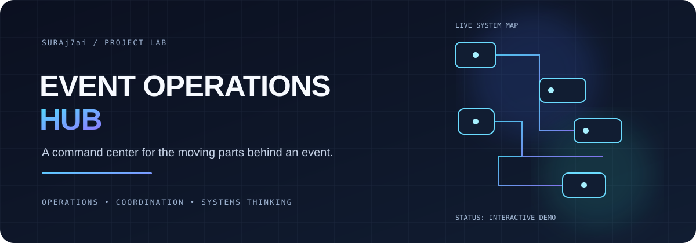
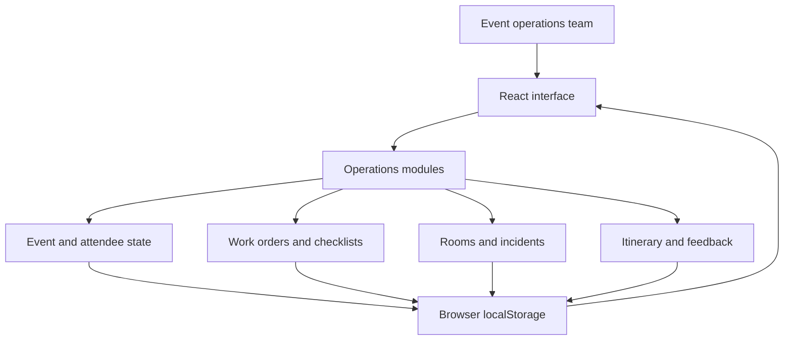

<div align="center">
  
</div>

<div align="center">

### One event. Many moving parts. One operations hub.

A hands-on event operations dashboard concept for coordinating schedules, attendees, rooms, work orders, checklists, and incidents from one place.

[Explore the code](https://github.com/Suraj7ai/Event-organizer) · [Report an issue](https://github.com/Suraj7ai/Event-organizer/issues)

</div>

---

## What is this?

**Event Operations Hub** is an interactive frontend prototype that explores how event teams can keep operational details in one place instead of juggling disconnected checklists and updates.

It is designed around the practical work that happens before and during an event: preparing rooms, checking readiness, coordinating people, tracking incidents, and keeping the run of show on schedule.

> **Project status:** Interactive prototype. It uses seeded demo data and browser local storage for persistence. It should not be treated as a production event-management system.

## What you can explore

- **Operations dashboard** — a central view of event operations.
- **Work-order tracking** — follow operational tasks and their statuses.
- **Readiness checklists** — verify preparation steps.
- **Room readiness matrix** — inspect room status at a glance.
- **Attendee check-in** — explore the check-in workflow and attendee information.
- **Itinerary tracking** — follow the run of show and schedule.
- **Incident dispatch** — model how operational issues can be surfaced and tracked.
- **Post-event feedback** — capture the feedback loop after the event.
- **Run-of-show export** — explore exporting event schedule information.
- **Role-aware experience** — switch between user roles in the demo.
- **Browser persistence** — changes are stored locally in the browser using `localStorage`.

Feature availability and behavior may evolve as the prototype develops.

## Technology stack

| Technology | Purpose |
| --- | --- |
| React 19 | Component-based user interface |
| TypeScript | Typed application code |
| Vite | Local development server and production build |
| Tailwind CSS 4 | Styling and layout |
| Lucide React | Interface icons |
| Motion | UI animation |
| QRCode | QR-code functionality used by the project dependencies |

## How the pieces fit together



This diagram describes the current frontend prototype at a high level. The app initializes from sample data, manages state in the browser, and saves supported changes to local storage. It does **not** imply that a production backend or shared multi-user database is currently configured.

## Run it locally

### 1. Install Node.js

Install a current LTS version of Node.js from the official [Node.js website](https://nodejs.org/).

### 2. Download the project

```bash
git clone https://github.com/Suraj7ai/Event-organizer.git
cd Event-organizer
```

### 3. Install dependencies

```bash
npm install
```

### 4. Start the development server

```bash
npm run dev
```

Open the local address printed in your terminal. The project is configured to use port `3000` by default.

### 5. Create a production build

```bash
npm run build
```

To run the built app locally for a preview:

```bash
npm run preview
```

## Repository map

```text
Event-organizer/
├── assets/
│   └── event-ops-banner.svg
├── src/
│   ├── components/     # Operations modules and interface components
│   ├── data            # Seed/demo data
│   ├── types           # Shared TypeScript types
│   └── App.tsx         # Main application and state
├── index.html
├── package.json
└── README.md
```

## Current scope and limitations

- Data is stored in the current browser, so it is not automatically shared across users or devices.
- The repository should be reviewed before using it with real attendee information or live events.
- Production use would require decisions around authentication, authorization, shared persistence, data privacy, observability, and deployment.
- Integrations and external-service behavior should be verified in the code and configured environment before being described as production-ready.

## Roadmap

- [ ] Add screenshots of the running application.
- [ ] Document and verify the key user workflows.
- [ ] Add automated checks for linting and production builds.
- [ ] Improve setup and troubleshooting documentation.
- [ ] Evaluate a secure backend and shared persistence for multi-user use.
- [ ] Document accessibility, security, and deployment considerations.

## Why I built it

This project explores the operational side of software: how a clear interface and structured workflows can help people coordinate work when many details change at once.

I am interested in practical tools that reduce administrative friction, make status visible, and help teams move from scattered updates to a shared operating picture.

## Maintainer

**Suraj Nandavarapu**  
GitHub: [@Suraj7ai](https://github.com/Suraj7ai)

---

<div align="center">
  <sub>Built to learn, iterate, and make operational work easier to reason about.</sub>
</div>
